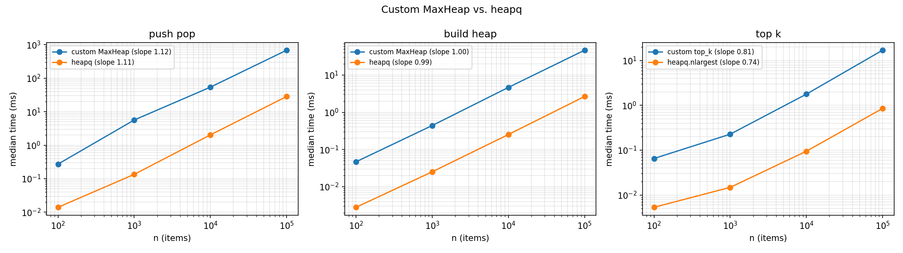
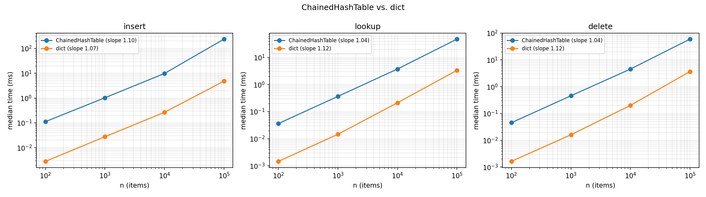

# Unified System Resource & Memory Optimization Suite

CSE 20312 final project. A system diagnostic tool built on custom data structures:

1. **Core Engine**: ranks resource-heavy processes and flags idle ones.
2. **Subtree Profiler**: totals CPU/RAM across process families using graph traversal.
3. **Memory Leak Simulator**: simulates `malloc`/`free` and finds leaked blocks by reachability.

See [`project_proposal.md`](project_proposal.md) for the design and [`BUILD_PLAN.md`](BUILD_PLAN.md) for the build plan.

## Status

| Phase | Status |
| :--- | :--- |
| 0. Setup | ✅ Done |
| 1. Bootstrap data structures + benchmarks | ✅ Done |
| 2. Data sources, ingestion & ranking | ⏳ Not started |
| 3. Subtree profiler | ⏳ Not started |
| 4. Memory leak simulator | ⏳ Not started |
| 5. Charts, testing pass & report | ⏳ Not started |

## Setup

Requires Python 3.9+.

```bash
python3 -m venv .venv
source .venv/bin/activate
pip install -r requirements.txt
```

## Running the Tests

Run from the project root:

```bash
python3 -m unittest discover -v
```

| Module (sample functions) | Test file | What the tests check |
| :--- | :--- | :--- |
| [`sysopt/structures/heap.py`](sysopt/structures/heap.py): `MaxHeap`, `MinHeap`, `top_k` | [`tests/test_heap.py`](tests/test_heap.py) | Extract order matches `sorted()`, heap property after every operation, `build_heap`, top-K edge cases (k = 0, k > n, duplicates) |
| [`sysopt/structures/hash_table.py`](sysopt/structures/hash_table.py): `ChainedHashTable`, `hash_key` | [`tests/test_hash_table.py`](tests/test_hash_table.py) | Insert/get/update/delete, forced collisions, resizing at load factor 0.75, `(pid, create_time)` keys, 1,000 random operations checked against `dict` |

## Bootstrap Benchmarks

The custom heap and hash table are compared against Python's built-in `heapq` and `dict` at n = 100 to 100,000:

```bash
python3 benchmarks/bench_heap.py
python3 benchmarks/bench_hash_table.py
python3 benchmarks/plot_benchmarks.py
```

Results go to `benchmarks/results/*.csv`, and charts to `report/figures/`. The built-ins are written in C, so they run about 15–50× faster. Both versions grow at the same rate: the fitted log–log slopes match. For example, push/pop is 1.12 for the custom heap and 1.11 for `heapq`, and build-heap is 1.00 vs. 0.99.




## Project Layout

```
sysopt/
  structures/   custom data structures (heap, hash table; graph and linked list coming)
  sources/      process data sources (live psutil / JSON snapshots)      [Phase 2]
  engine/       registry, idle detection, monitor                        [Phase 2]
  profiler/     process subtree aggregation                              [Phase 3]
  leaksim/      simulated heap and leak detection                        [Phase 4]
  viz/          matplotlib charts                                        [Phase 5]
tests/          unittest files
benchmarks/     benchmark scripts and results
fixtures/       JSON process snapshots for tests
report/         final report and figures
```
