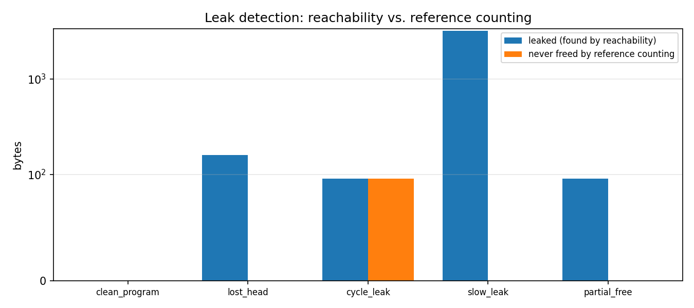
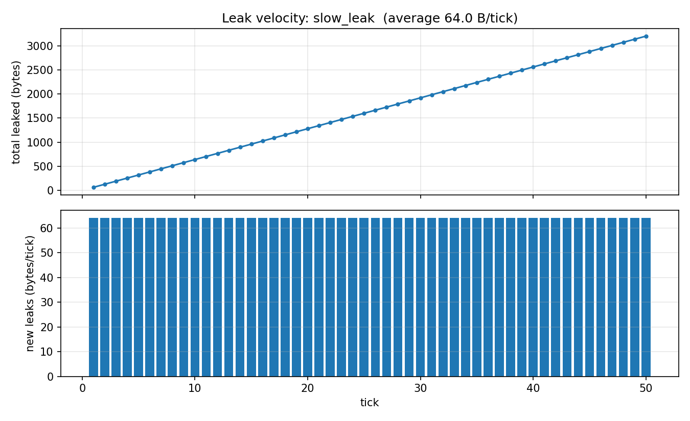
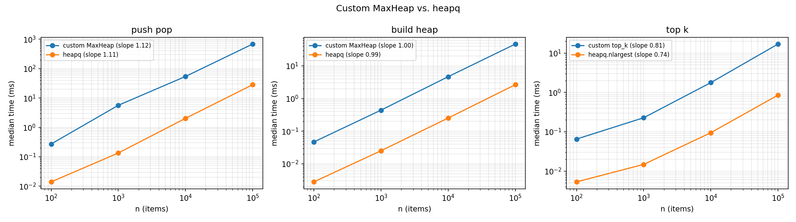
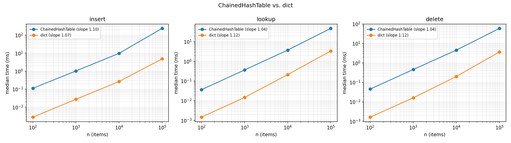
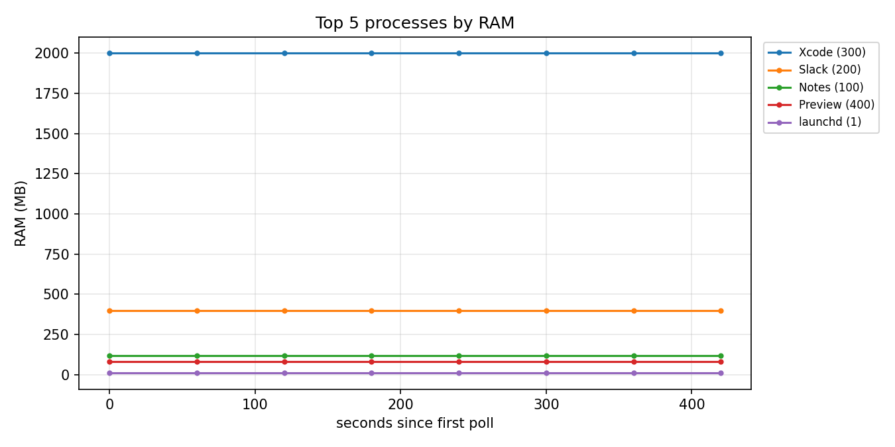
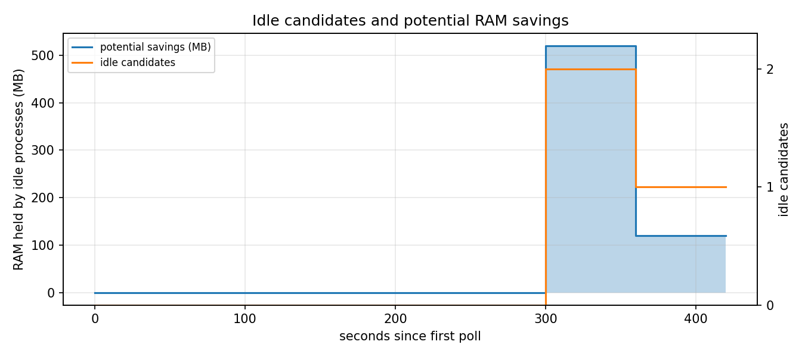

# Final Report: Unified System Resource & Memory Optimization Suite

CSE 20312 Final Project

## 1. Overview

This project is a system diagnostic tool for macOS (and other systems `psutil` supports). Four data structures built from scratch power three subsystems:

| Subsystem | What it does | Main data structures |
| :--- | :--- | :--- |
| **Core Engine** | Polls every process, ranks the top K by CPU or RAM, and flags idle apps along with the memory closing them would free. It never closes anything. | Hash table (process registry), heap (top-K ranking) |
| **Subtree Profiler** | Builds the parent → child process graph and totals CPU and RAM for any process plus everything it spawned, so a browser's 20 helper processes count as one app. | Directed graph (adjacency lists), BFS / DFS |
| **Memory Leak Simulator** | Simulates a C heap with `malloc` and `free`, and finds leaked blocks by reachability from the program's variables, the "mark" phase of mark-and-sweep garbage collection. | Doubly linked list + hash table (O(1) `free`), graph reachability |

Everything is reachable from one command-line tool (`python3 -m sysopt top | watch | tree | families | leaks`). Each command runs on live data or on recorded JSON fixtures.

## 2. Design

### 2.1 Hash table: separate chaining

`ChainedHashTable` (`sysopt/structures/hash_table.py`) stores `[key, value]` pairs in per-bucket lists and doubles its capacity when the load factor passes 0.75. It uses its own 32-bit hash function, not Python's `hash()`:

| Key type | Hash |
| :--- | :--- |
| Integers | Multiplicative hashing (`key × 2654435761`) |
| Strings | Polynomial rolling hash (`h = 31h + c`) |
| Floats | Hashed at millisecond precision |
| Tuples | Element hashes combined in order |

**Why chaining instead of linear probing:** processes exit constantly. Deleting from a linear-probing table needs tombstones, which slowly fill the table and lengthen probes. With chaining, delete just swaps the pair with the last one in its bucket and pops it. Every subsystem uses this table: the process registry, the PID index, the graph's adjacency lists, traversal "visited" sets, and the leak simulator's address map.

**Process identity:** processes are keyed by `(pid, create_time)`, not PID alone, because the OS reuses PIDs. Without that, a new process reusing an old PID would inherit the old one's idle timer.

### 2.2 Heaps and top-K

`MaxHeap` (`sysopt/structures/heap.py`) is a binary heap stored in a Python list. It uses raw index arithmetic: parent `(i−1)//2`, children `2i+1` and `2i+2`. `MinHeap` is the same code with the comparison reversed.

**Why the heap is rebuilt every poll:** CPU and RAM values change on every poll, and a plain binary heap can't update a key in place. Rather than build an indexed heap (a hash map from PID to heap position, with an O(log N) `update_key`), each poll selects the top K from scratch:

> `top_k(items, k)` keeps a **min-heap of size K** whose root is the smallest of the current top K. Each new item is either ignored or replaces the root. That takes **O(N log K)** time and O(K) space, and the input isn't modified.

With N ≈ 700 processes and K = 10, that's about 700 × log₂ 10 ≈ 2,300 comparisons per poll, which is negligible. An indexed heap would only pay off with far more processes, or if the top K were read many times between updates.

### 2.3 Directed graph

`DirectedGraph` (`sysopt/structures/graph.py`) stores two adjacency lists in hash tables: out-neighbors (children) and in-neighbors (parents). Keeping both directions makes `roots()` and `remove_vertex()` cheap. The traversals:

- **BFS** uses a queue.
- **DFS** uses an explicit stack instead of recursion, so a 5,000-level chain works without hitting Python's recursion limit. Children are pushed in reverse, so DFS visits them in the same order a recursive version would.
- **`reachable(starts)`** is a BFS from several starting points at once. The leak detector uses it.

All three keep a "visited" table, so they finish on graphs with cycles. Process trees can't have cycles, but the leak simulator's pointer graph can.

**A complexity bug found while writing this report:** `add_edge` originally always checked for a duplicate edge by scanning the parent's child list, which costs O(deg). On macOS, launchd (PID 1) has about 600 children, so building the tree cost O(Σ deg²). Timing a parent with d children confirmed it:

| Children d | Before | After `check_duplicate=False` |
| ---: | ---: | ---: |
| 1,000 | 8.5 ms | 6.3 ms |
| 2,000 | 22.0 ms | 12.7 ms |
| 4,000 | 63.8 ms | 25.2 ms |

Before the fix, doubling d nearly tripled the time (quadratic growth). After it, doubling d doubles the time (linear). The process tree can safely skip the check because each process has exactly one parent, so a parent → child edge can never repeat.

### 2.4 Doubly linked list + hash table

The leak simulator has to free any block by address in O(1). A linked list alone would need an O(M) search to find the node. Pairing it with a hash table from address to list node makes `free()` a hash lookup plus an O(1) unlink. The list keeps blocks in allocation order for reports. It uses empty marker nodes (sentinels) at both ends, so unlinking the first or last block needs no special case.

### 2.5 Leak detection: reachability vs. reference counting

A block is leaked when it's still allocated but no chain of pointers from any root (stack variable) reaches it. Detection builds a graph with roots and live blocks as vertices and pointers as edges, then calls `reachable(roots)`. Every allocated block that isn't reached is leaked.

`refcount_misses()` runs a reference-counting collector on the same heap for comparison. Any block whose count is 0 is freed, which lowers the counts of the blocks it points to, and the freeing cascades. Whatever leaked block survives is something reference counting can never reclaim.



| Scenario | What the program does | Leaked (reachability) | Never freed by ref. counting |
| :--- | :--- | ---: | ---: |
| `clean_program` | Builds a 5-node list, frees every node | 0 B | 0 B |
| `lost_head` | Sets `head = NULL` without freeing | 160 B (5 blocks) | 0 B |
| `cycle_leak` | A ↔ B point at each other; the root goes out of scope | 96 B (2 blocks) | **96 B** |
| `slow_leak` | Forgets to free a 64 B buffer every tick for 50 ticks | 3,200 B (50 blocks) | 0 B |
| `partial_free` | `free(head)` on a 4-node list | 96 B (3 blocks) + 1 dangling pointer | 0 B |

The cycle is the only case reference counting misses. A and B each still have one reference, from each other. `partial_free` looks similar at first, since nodes 3 and 4 still have a reference count of 1. But reference counting does free them: once node 2 hits 0 and is freed, node 3 drops to 0, and so on down the chain. My first version of the report output got this wrong. It flagged any leaked block with a count above 0, which is why the final version simulates the full cascade.

**Leak velocity** is the number of bytes newly leaked per tick. `slow_leak` shows a constant 64 B/tick, which is the signature of a leak inside a loop:



A one-time leak like `lost_head` shows up as a single jump instead (see `figures/leak_velocity_lost_head.png`).

## 3. Bootstrap Results

The custom heap and hash table were benchmarked against Python's `heapq` and `dict` at n = 100; 1,000; 10,000; and 100,000. Each time is the median of 5 runs with fixed random seeds (`benchmarks/`).




| Experiment | Custom (n = 100,000) | Built-in | Ratio | Slope (custom) | Slope (built-in) |
| :--- | ---: | ---: | ---: | ---: | ---: |
| Heap push all, pop all | 684 ms | 28.3 ms | 24× | 1.12 | 1.11 |
| Build heap | 46.5 ms | 2.6 ms | 18× | 1.00 | 0.99 |
| Top-10 selection | 17.0 ms | 0.86 ms | 20× | 0.81 | 0.74 |
| Hash insert | 239 ms | 4.8 ms | 49× | 1.10 | 1.07 |
| Hash lookup | 47.5 ms | 3.4 ms | 14× | 1.04 | 1.12 |
| Hash delete | 59.6 ms | 3.7 ms | 16× | 1.04 | 1.12 |

**Reading the slopes:** each slope is fitted on a log–log plot of time vs. n, so it shows how fast the time grows. A slope of 1.0 is linear growth. N log N growth shows up as slightly above 1 over this range (about 1.1). In every experiment, the custom and built-in slopes are close. The built-ins are written in C, so they're faster by a constant factor (14–49×), but they grow at the same rate.

- **Push/pop:** both ≈ 1.1, which is O(N log N) for N operations at O(log N) each.
- **Build heap:** 1.00 vs. 0.99, confirming bottom-up heapify is O(N), not O(N log N).
- **Hash table:** about 1.0 per batch of N operations, so each operation is O(1) on average.
- **Top-10:** below 1, because at small n the fixed cost of building the size-10 heap dominates. As n grows, the scan of every item takes over.
- **Hash insert is the slowest relative to `dict` (49×):** it includes the cost of rehashing every key when the table doubles. That's O(N) per resize, but it happens only O(log N) times, so the amortized cost per insert is still O(1).

## 4. Complexity Analysis

Each row was checked against the code. N = processes, K = top-K size, V/E = vertices/edges, M = live blocks, R = roots, P = pointers stored in blocks.

| Operation | Implementation | Time | Space |
| :--- | :--- | :---: | :---: |
| Hash insert / lookup / delete | Separate chaining, resize at load factor 0.75 | O(1) average, O(N) worst; amortized O(1) insert | O(N) |
| Heap insert / extract | Sift up / sift down | O(log N) | O(N) |
| Build heap | Bottom-up heapify | O(N) | O(N) |
| Top-K per poll | Size-K min-heap | O(N log K) | O(K) |
| Registry update per poll | Hash insert/update per process + scan for exited ones | O(N) average | O(N) |
| Idle check per poll | O(1) per process | O(N) | O(1) extra |
| Build process tree | One hash insert + one edge per process | O(V) | O(V + E) |
| Subtree totals | BFS or DFS over the subtree | O(V_s + E_s) | O(V_s) |
| All family totals | Families don't overlap, so every vertex is visited once | O(V + E) | O(V) |
| Top families | `top_k` over F families | O(F log K) | O(K) |
| `malloc` | Linked-list append + hash insert | O(1) average | O(1) |
| `free` | Hash lookup + linked-list unlink | O(1) average | O(1) |
| Leak detection | Build pointer graph + multi-source BFS | O(R + M + P) | O(R + M) |
| Reference-counting simulation | Count references, then cascade | O(R + M + P) | O(M) |

**One improvement over the proposal:** the proposal listed process-tree building implicitly as O(V + E). Section 2.3 shows the first version of the code was actually O(Σ deg²) because of the duplicate-edge check, and it now matches the O(V) in this table.

## 5. Results on a Real Machine

A 60-second session (30 polls, 2 seconds apart) was recorded on a MacBook with `watch --record`. Specific apps are described generically below, because the recording lists every running process. The charts from this session are in `report/figures/local/`, which is kept out of the public repository.

| Measurement | Value |
| :--- | :--- |
| Processes | 697–708 during the session (35 started, 25 exited) |
| Restricted (macOS denied CPU/RAM readings without `sudo`) | 212 (30%), all system processes |
| Owned by the user | 494 |
| Families (top-level processes and everything they spawned) | 610, of which 597 are single-process system daemons |
| Largest family | A web browser: 20 processes, about 2.8 GB RAM |
| Second largest | A desktop app built on Electron: 23 processes, about 2.6 GB |
| Idle candidates at the end of the session (CPU < 1% for 30 s, ≥ 50 MB) | 51 processes holding about 5.4 GB |

**What the family view adds:** in the top-K list sorted by RAM, the browser shows up only as a handful of separate "Helper (Renderer)" rows of about 230–450 MB each. The family view adds those together and shows the browser is the single largest consumer, at about 17% of all the user's RAM.

The same charts can be made from the test data, which is committed and safe to share:




In the savings chart, Notes and Slack both become idle at t = 300 s (520 MB). Slack's CPU spike at t = 360 s resets its idle timer, so the savings drop to Notes' 120 MB.

## 6. Testing

```bash
python3 -m unittest discover -v
```

There are 208 tests, and all of them pass. Every test except one live smoke test runs on hand-written JSON fixtures, so results are the same on every machine. Each fixture lists its expected answers inside the file (for example, the hand-calculated subtree totals in `fixtures/small_tree.json`).

| Test file | Tests | Covers |
| :--- | ---: | :--- |
| `test_heap.py` | 19 | Extract order vs. `sorted()`, heap property after every operation, `build_heap`, top-K edge cases |
| `test_hash_table.py` | 15 | Collisions, resizing, tuple keys, 1,000 random operations checked against `dict` |
| `test_graph.py` | 19 | BFS/DFS order, cycles, multi-source `reachable`, removal, 5,000-deep chain |
| `test_linked_list.py` | 8 | Unlink at the head, middle, and tail; double unlink; random unlinks vs. a Python list |
| `test_sources.py` | 20 | Fixture validation, record/replay, `psutil` errors (using fake processes), live smoke test |
| `test_registry_idle.py` | 16 | Process exit, PID reuse, re-parenting, idle exactly at T, CPU spike resets the timer |
| `test_monitor.py` | 20 | Ranking, idle candidates, savings, filters, history not changed by later polls |
| `test_subtree.py` | 23 | Hand-calculated subtree totals, families, name search, rendering |
| `test_leaksim.py` | 37 | `malloc`/`free` errors, reachability, cycles, reference-counting cascade, dangling pointers, velocity, all 5 scenarios |
| `test_cli.py` | 18 | Every command on fixtures, `--record`, errors and exit codes |
| `test_charts.py` | 10 | Every chart writes a valid PNG; empty input is rejected; every `--plot` flag works |
| `test_integration.py` | 3 | One source feeding all subsystems: families cover every process exactly once, and family RAM adds up to total RAM |

**Coverage** (`coverage run --source=sysopt -m unittest discover`): 98% of statements overall, and 97–98% for each data structure.

**Bugs the tests caught during development:**
1. **Self-loop edge count:** `remove_vertex` miscounted edges when a vertex had an edge to itself.
2. **`watch --record` saved 0 polls:** the recorder has a length of 0 before its first poll, so `recorder or source` treated it as false and skipped it.
3. **Results changed after the fact:** `PollResult` kept references to registry records, which are updated in place, so a CPU spike in an earlier result was overwritten by the next poll's value. Caught by the end-to-end test. Results now store copies.
4. **Wrong reference-counting claim:** described in Section 2.5.

## 7. Limitations & Future Work

- **Idle is inferred, not observed.** The OS doesn't report when a user last used an app, so "idle" means CPU below a threshold for T seconds. A music player streaming audio or a chat app waiting for messages can look busy or idle in misleading ways.
- **Restricted processes.** Without `sudo`, 30% of processes (all system ones) deny CPU and RAM readings. They're listed but left out of rankings and totals, and subtree totals report how many members had no readings.
- **Family boundaries on macOS.** Safari tabs and other WebKit pages (`com.apple.WebKit.WebContent`) are started by launchd through XPC rather than by the app, so each appears as its own one-process family instead of under Safari. Grouping families by name, or by app bundle, would fix this.
- **RSS counts shared memory more than once.** Summing RSS across a family can overstate its true footprint. PSS or USS (`psutil.memory_full_info`) would be more accurate, but needs more permissions and is slower.
- **Indexed heap.** Rebuilding the top K each poll is O(N log K). An indexed heap with `update_key` could maintain the ranking incrementally. That was the main stretch goal and wasn't needed at about 700 processes.
- **The leak simulator is a model.** It tracks pointers the program declares explicitly. A real C leak checker (such as Valgrind or AddressSanitizer) has to scan raw memory conservatively for anything that looks like a pointer.
